# Federated authentication — two flows

Microsoft is the only staff identity provider. Patients are excluded. Federated
login never creates a HealthCore user. Task 1 CTO signoff does not cover this
task.

External sanitized publication text and live IdP evidence (no secrets):

- `C:\Users\cruzd\Documents\Codex\2026-11-04\task\healthcore-task2-pr-draft.md`
- `C:\Users\cruzd\Documents\Codex\2026-11-04\task\healthcore-task2-live-evidence.md`

Those files remain authoritative for executed live Microsoft results. This
document describes the implemented flows in this worktree.

```mermaid
flowchart TD
  subgraph linkFlow [Flow 1 - Link from an existing staff profile]
    L1[IT-provisioned staff signs in with email and password] --> L2[Profile starts Microsoft OAuth purpose=link]
    L2 --> L3[Signed state, nonce, tx_binding, allowlisted redirect_uri]
    L3 --> L4[Callback binds Microsoft oid or sub to that user]
    L4 --> L5[Store link row plus email_at_link_time snapshot]
    L5 --> L6[Audit federated_link - no Microsoft tokens stored]
  end
  subgraph loginFlow [Flow 2 - Login with an already-linked identity]
    S1[Visitor chooses Sign in with Microsoft purpose=login] --> S2[Lookup provider=microsoft plus provider_user_id]
    S2 -->|link exists| S3[Issue the same JWT session as password login]
    S3 --> S4[Existing role and department unchanged]
    S2 -->|no link including unknown oid| S5[Reject - federated_login_rejected]
    S5 --> S6[user_id null - zero User rows created]
  end
```

The flows do not share a path that could onboard by presenting a Microsoft account.

## Constraints

- Provider code `microsoft` only.
- `audience=staff` and `provisioned_by_it=true` before linking.
- Unique `provider` + `provider_user_id`.
- Email snapshot is not a join key.
- Unlink lives on the same profile. Last remaining access method: UI warns, API refuses.
- OAuth validates signed `state`, hashed `tx_binding`, allowlisted `redirect_uri`, and explicit tenant.
- Microsoft access/refresh tokens are not persisted.
