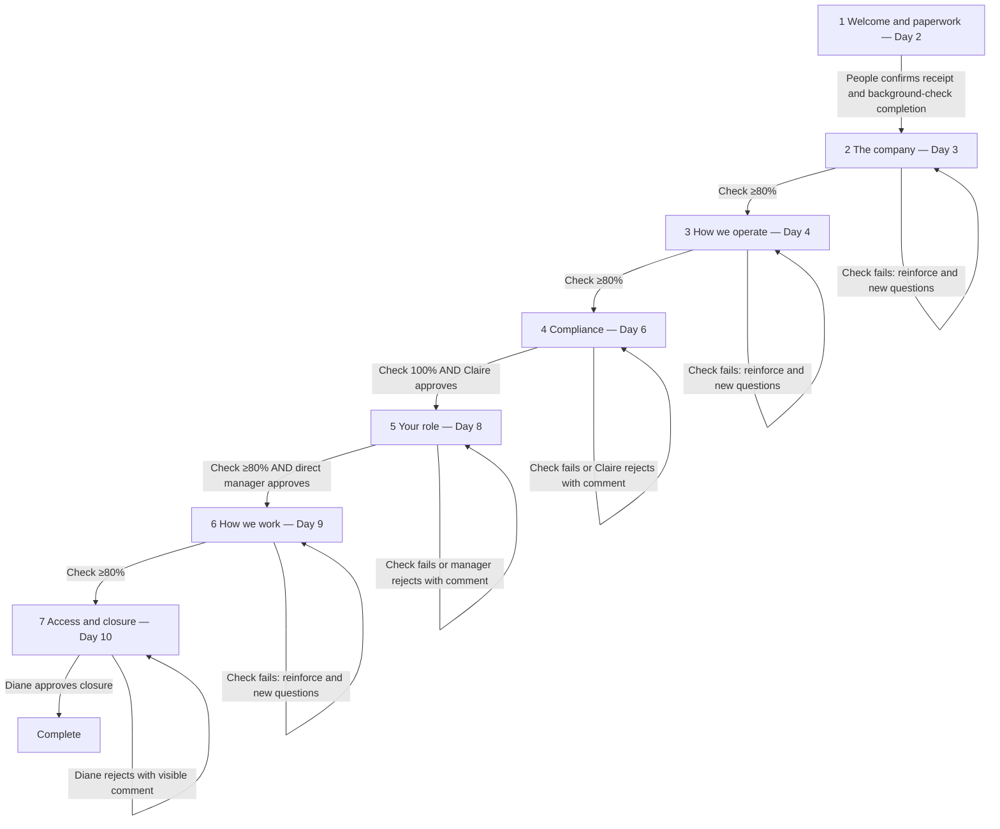

# Single-agent architecture and stage graph

## Why one agent

Onboarding is one sequential responsibility for one hire. At any moment there is exactly one next required action. The failure mode is lost state across days, restarts, and human waits, not parallel reasoning. One explicit stage graph, one SQLite checkpointer thread per onboarding, and one lookup tool over official documents is simpler, cheaper, and easier to audit than coordinating content, paperwork, and Q&A agents.

Approvals are LangGraph interrupts. The process does not continue until an authorized human resumes that thread. Background Celery (or an eager in-process worker in tests) runs the graph outside the HTTP handler.

## Stage graph

Stage 4 approval gates every patient-information system access request, including requests made before stage 7 or through a direct API. Failed early access is denied, written as a security audit event, and routed to Claire. It never advances state.

## Calendar policy (explicit fixture settings)

The briefing sets a 10-business-day target and stage day numbers 2/3/4/6/8/9/10, plus a 24-hour reminder. It does not define a holiday calendar, timezone, cutoff hour, or whether the start date counts as Day 1. Those remain injectable `CalendarPolicy` fields. Tests must set them. The agent does not invent a real HealthCore holiday calendar or a local-office cutoff.
