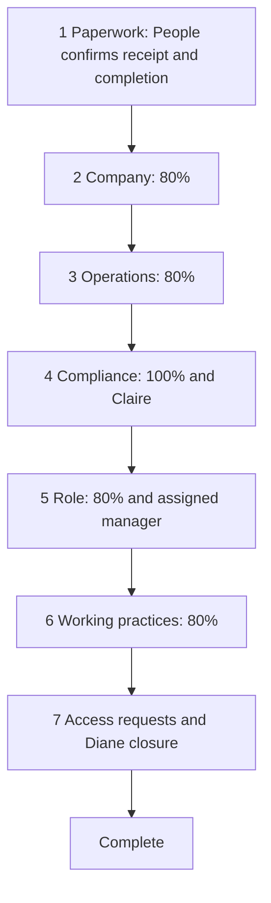

# Add persistent corporate onboarding with authorized human gates

Local draft for developer Git review. Not published. Not a People-team signoff. Copied from `C:\Users\cruzd\Documents\Codex\2026-11-04\task\healthcore-task3-pr-draft.md` on 2026-11-06.

Corporate onboarding needs to survive multi-day waits and restarts while keeping compliance, manager and People approvals separate. This change adds one persistent seven-stage LangGraph orchestrator, Celery background execution, scoped People/hire views, comprehension checks, official-material Q&A, and deadline processing.

The compliance check requires 100% plus Claire's approval before patient-system requests are accepted. The role stage requires the assigned manager; Diane closes onboarding. Rejections restart the stage and show the hire the comment. Other checks require 80%. Sensitive document details are excluded from the tested ingress, checkpoint, audit and response paths.

## Scope

- Task 3 worktree: `C:\4geeks\Projects\Capstone\healthcore-onboarding-orchestrator`, branch `feature/onboarding-orchestrator`.
- Non-clinical corporate staff in Austin/London, with HIPAA/UK GDPR and two role variants.
- Graph, architecture rationale and official content: `agents/onboarding_orchestrator/` and `data/raw/healthcore-onboarding/`.
- API/worker integration and onboarding routes/components in the existing tracker.
- Minimal existing-app registration/navigation, Celery configuration, test-isolation allowlist and onboarding content styles.

## Graph and persistence

One agent owns the sequential responsibility for each hire. SQLite checkpoints preserve interrupted graph state; independent onboarding identifiers isolate hires. Projection updates and first initialization hold process/thread locks. The UI waits for a terminal successful worker job before refreshing and disables duplicate submission while pending.

## Executed evidence

| Check | Result |
| --- | --- |
| Final graph selection | 35 passed; JUnit clean |
| Final API selection | 4 passed; JUnit clean |
| Before/after source identity for those selections | Unchanged; both exits and runner exit 0 |
| Client auth/delayed result/failure/timeout/cancellation | 6 passed; mocked client tests |
| Tracker lint | Exit 0; one unused-import warning in test code |
| Final production build/TypeScript | Exit 0; source unchanged; explicit isolated API origin |
| Six simultaneous fresh-start projection writers | 240/240 records; all child exits 0 |
| Separate-process checkpoint resume | Pending stage, attempts and nonce restored; successful continuation |
| Real non-eager worker transport | HTTP 202 followed by SUCCESS and matching worker receipt/completion |
| Autonomous Celery beat/worker | No HTTP; exactly three expected notices; no duplicate or compliance bypass; source unchanged |
| Rendered Austin journey | All seven stages complete, including Claire rejection/comment/retry/approval, manager gate and Diane closure |
| Department isolation | Unrelated Revenue manager saw no Austin approval item |
| Patient-system request gate | Early EHR request denied; request accepted after compliance approval |
| London Q&A | UK policy citation/wording, without US-only guidance |
| Content layout | Page width equals viewport width at 1265 px after wrapping correction |
| Shared Celery contract | Eight existing contract assertions passed with only obsolete fixture setup adapted in memory; original validator and production authorization unchanged |

The shared contract adapter creates its fictional user through the existing service because the old validator assumes unauthenticated `POST /users`. It invokes only `run_contract`; it does not invoke the validator's default runtime branch. This is separate from the actual worker-transport proof.

## Unsupported-question example

The rendered question about an undocumented HIPAA breach fine returned an uncovered answer routed to Claire, with no invented fine. A generic notification-window question from the London fixture cited `stage-04-compliance-uk-gdpr`.

## Evidence locations

Detailed findings, corrections and run paths: `C:\Users\cruzd\Documents\Codex\2026-11-04\task\healthcore-task3-review-findings.md`.

- Final graph/API JUnit: `%TEMP%\task3-onboarding-verify-20261106\run-20261106T021003592-a0f15471\junit\`.
- Final UI build: `task3-ui-final-20261106T015037480\result.json` beside the detailed report.
- Autonomous deadline proof: `task3-autonomous-deadline-76_8s15z\result.json` beside the report.
- Shared contract: `task3-shared-contract-w6d0l25r\result.json` beside the report.
- Live isolated stack: `%TEMP%\task3-onboarding-verify-20261106\worker-ui-20261106T012847765\`.
- Current refresh identities/logs: its `refresh-20261106T022029504\` subdirectory.

## Review boundaries

Notifications were verified through the internal outbox; no real communications were sent or external delivery integration claimed. Calendar defaults and the 60-second sweep cadence are explicit local test/operational settings, not approved HealthCore HR policy. The installed locked dependency tree reported audit findings; dependency upgrades were not part of this change.

The fictional Diane closure is test evidence, not real People-team signoff. Real People review/signoff and Daniel review before merge remain pending. Daniel authorized the supervisor to commit and push this scoped branch for review; Cursor must never commit. No merge is authorized.
