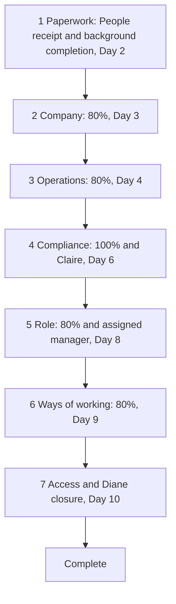

Corporate onboarding now persists one seven-stage LangGraph per fictional hire, runs graph work through Celery, and stops at authorized People, Compliance, manager and closure decisions. Company/operations/role/working-practice material is indexed official content, with jurisdiction-aware compliance, scored checks, citations and explicit human routing for uncovered questions.

The branch incorporates approved Task 2 main `677cce9`, preserves its federation/auth implementation, and resolves both tasks' shared test-isolation/progress conflicts. No merge of PR #40 into main is authorized.

## Stage graph and single-agent rationale

One agent owns the sequential next action for each hire; SQLite checkpoints and isolated thread IDs preserve multi-day waits and service restarts. This avoids multi-agent coordination for a single ordered process. Failed content checks reinforce official material and switch question banks; rejected human decisions return to the stage with a comment visible to the hire. Patient-information access requests before Claire's stage-4 approval are denied, audited and routed to Claire.

Five reproduced issues are corrected: duplicate queued decisions consuming one nonce, deadline sweeps overwriting a newer stage, punctuated compliance questions routed incorrectly, missed unlabeled identifier formats, and human notices that lacked the question. Decisions and deadline mutations now share the durable lock. Internal notices resolve the recipient user ID and carry privacy-checked uncovered questions without copying them to checkpoints/audit.

## Executed verification

| Check | Result |
| --- | --- |
| Current agent regressions | 41 passed; includes complete seven-stage journey, Diane rejection/approval, race counterexamples, privacy, Q&A, thresholds, restart and timing/DST |
| Current onboarding API | 5 passed; scoped views/authorization, early-access denial, async contract, no-echo/no-store-mutation privacy |
| Task 2 compatibility | 32 federation and 60 mixed auth/onboarding tests passed before the final notice-payload-only change; the five affected onboarding API tests passed again afterward. Other 55 auth tests and main auth modules unchanged. Counts overlap. |
| UI | Full TypeScript, full ESLint, all 72 Jest tests (9 suites) and disposable production build exit 0; no source drift |
| Separate-process restart | Two child exits 0; exact pending stage/attempts/nonce restored, then successful continuation |
| Current real Celery worker/beat | No HTTP; exactly hire reminder, manager overdue and Diane compliance-overdue notices, no duplicates or compliance bypass; only newly created proof children stopped |
| Source/dependencies | Stable code hashes during checks, Python syntax/diff checks and offline `uv lock --check` pass; no dependency upgrades |

## Source review and evidence

- [Every Task 3 requirement and source reconciliation](https://github.com/DAC-004/ai-engineering-company-project-monorepo-DanielCruz/blob/feature/onboarding-orchestrator/agents/onboarding_orchestrator/SOURCE-COMPLIANCE.md)
- [Machine-readable current validation, source hashes and counterexamples](https://github.com/DAC-004/ai-engineering-company-project-monorepo-DanielCruz/blob/feature/onboarding-orchestrator/agents/onboarding_orchestrator/review-validation.json)
- [Executed uncovered-question handoff example](https://github.com/DAC-004/ai-engineering-company-project-monorepo-DanielCruz/blob/feature/onboarding-orchestrator/agents/onboarding_orchestrator/uncovered-question-example.json)
- [Architecture and full graph](https://github.com/DAC-004/ai-engineering-company-project-monorepo-DanielCruz/blob/feature/onboarding-orchestrator/agents/onboarding_orchestrator/ARCHITECTURE.md)

The example asks “Which HIPAA policy covers the fictional lunar office?” It is explicitly uncovered, routed to the configured Claire identity through the internal outbox, and is absent from checkpoint/audit. Unsupported-fine and framework-specific notification-window tests also reject guessing or cross-jurisdiction answers.

Detailed local history: `C:\Users\cruzd\Documents\Codex\2026-11-04\task\healthcore-task3-review-findings.md`. Earlier rendered Austin journey completed all seven stages, including Claire rejection/comment/retry/approval, assigned-manager approval, Diane closure and early/past-compliance access behavior. London Q&A cited UK GDPR material; unrelated managers saw no approval item. Those are historical browser results, not a newly recorded browser run for this backend correction. Current onboarding UI source is unchanged; shared UI integration has fresh build/type/lint/Jest checks. Earlier six-process 240/240 projection and shared Celery eight-contract proofs remain documented; current-code restart and autonomous worker proofs are recorded separately above.

## Review boundaries

Only fictional non-clinical corporate fixtures are used; English material includes both compliance and the minimum two role variants. No real access provisioning, background-check outcomes, payroll documents or external email/Slack delivery. Calendar/holiday/cutoff/start-day choices and scheduler cadence are explicit operational/test settings, not approved HR policy. Existing long-lived services and original WIP were preserved and are not claimed to have been redeployed to this revision. Recorded installed dependency-audit findings are outside this functional change; no upgrade was hidden.

Real People-team signoff and Daniel's explicit review/merge approval remain pending. Fictional Diane closure is test evidence. Cursor never commits; the supervisor owns commits and pushes. Draft for review; do not merge without Daniel's later approval.
