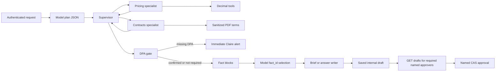

# Supplier and contract supervisor

Operations needs price history and contract terms in one answer, without anyone
talking to a supplier until named humans approve. Prices and contracts are
different sources and tools. A single mixed agent would keep irrelevant rows and
clauses in one context. A supervisor consults specialists with typed I/O, then
combines results. The consultation cap of four per request is an implementation
limit, not HealthCore policy.

No specialist or supervisor has a send-to-supplier tool. Drafts stay internal
(`sent=false`) until named approvers complete CAS approval. There is still no
outbound supplier message.

## Specialist contracts

Pricing input: `supplier_id`, optional `product`, inclusive month range, and the
requested calculation (`history`, `increase`, `impact`, `compare`). Output:
Decimal strings, unit, currency, formula, source row IDs, same-country and
same-category alternatives, `quote_only`, and `missing` flags. The specialist
never converts floats to Decimal and never compares across country or category.

Contracts input: `supplier_id` or `contract_id` and a precise question. Context
is sanitized terms only. Output: structured fields with `pdf_sha256`, page,
clause number, confidence (`high` or `uncertain`), cap/notice/exit conditions,
and `missing_contract` / `missing_dpa` flags. Exit penalties whose averaging
period is unspecified stay `uncertain`; the amount is not invented from annual
value. Estimated annual value comes from the numbered PDF clause, not from
registry constants. Unknown or altered annual evidence does not drop Sandra
from brief/draft approval.

The supervisor copies specialist figures and citations. It does not recompute
percentages or caps in free text. USA in the existing Supplier Directory is
`USA`; briefing “United States” / “US” normalize at the adapter only.

## What is and is not a model

The Task 4 adapter reuses the existing configured generation transport
`data.pipelines.rag._run_generation_model`. It does not call
`generate_answer` and does not change the patient-coordinator RAG system
prompt, which forbids revealing confidential vendor terms.

With a transport injected, the model:

1. Plans: returns JSON `kind` and allowlisted `tools` for the staff question.
2. Writes: returns JSON `fact_ids` from the specialist catalog.

Deterministic code then consults specialists, validates IDs against the
catalog, always retains mandatory compliance/approval/source blocks, and
renders specialist text. The model does not compute prices, invent citations,
or author DPA/approval outcomes. Compare-only skip of contract PDFs applies
only to a true alternatives path; notice/expiry/deadline questions still load
contract terms even if the plan kind is mislabeled.

Keyword routing in `routing.py` is a fallback when no transport is injected or
the plan JSON is unusable. Fallback is not live model evidence. Patient-labeled
and out-of-scope input is rejected before any model call, context assembly, or
audit persistence. Released answers are the deterministic specialist render.
Model prose is never appended as grounded text.

Mocked transport tests are the default automated evidence. Live GGUF evidence
is a separate one-question Supervisor proof and is not claimed from the 53
non-live tests.

## Named approval and alerts

Authenticated `GET /supplier-contracts/drafts` lists persisted drafts the
caller is required to approve. `GET /supplier-contracts/drafts/{id}` returns
the same bound object. Wrong named identity, Employee, and unrelated
department do not receive another actor's draft. Approve posts version, hash,
and nonce from that payload; the UI does not ask staff to type those fields.

The DPA gate runs after specialist consults and before the brief writer.
Missing DPA blocks brief and draft immediately and enqueues Claire's alert
without a separate HTTP tick. Fictional Compliance proceed does not change
extracted `missing_dpa=True` into a signed-DPA claim. Named CAS approval
runs only after a draft is saved. Beat/worker on the owned Task 4 Redis
instance ticks remaining notice, expiry, and price alerts. External
communications stay disabled.

## Worked HC-S06 brief (traceable sources)

Thames Pathology, contract CT-HC-03, PDF SHA-256
`2abee9829e76e42c9faab5d52259f2e4aadf37e3b8cdaaafa8b4124dcbb5aae1`.
Price data rows `prices.csv:71` and `prices.csv:72` (header excluded):
previous 14.50 GBP, current 14.79 GBP. Annual impact
`(14.79-14.50)*700*12 = 2436` GBP; FX 1.27 gives 3093.72 USD. Clause 4 page 1
cap 3 percent allows 14.935 GBP. Clauses 2 and 3 page 1: expiry 2027-06-04,
notice 90 days, deadline 2027-03-06. Clause 5 page 1: exit with 90 days
notice and no penalty. Clause 6 page 1: DPA missing; fictional Claire proceed
does not claim a signed DPA. Clause 8 page 1 annual 121800 GBP converts to
154686 USD, so required named approvers are Marcus and Claire.

## File plan

| Path | Role |
| --- | --- |
| `agents/supplier_contracts/` | Supervisor, specialists, adapter, ingest, alerts, approvals, audit |
| `data/raw/healthcore-supplier-contracts/` | Seven-supplier registry, 12-month CSV, four English PDFs |
| `data/process/supplier-contracts/` | Isolated runtime projection, audit, outbox (gitignored) |
| `services/api/app/routers/supplier_contracts.py` | Thin authenticated routes including GET drafts; existing `/suppliers` CRUD unchanged |
| `uis/talent-pipeline-tracker` contracts page | Ask, persisted draft review, role-appropriate Approve/DPA; directory CRUD preserved |
| `services/api/app/tasks_supplier_contracts.py` | Celery tick; default schedule off until process env sets an interval |
