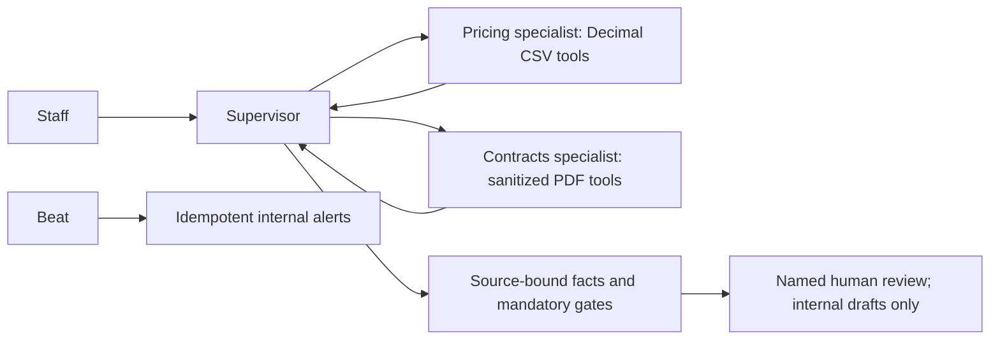

## Summary

Task 4 adds a supplier-contract supervisor in this worktree on
`feature/supplier-contracts`. A supervisor consults pricing and contracts
specialists, then answers Operations questions without a send-to-supplier
tool.

The model plans allowlisted tools and selects specialist fact IDs through the
existing configured transport `data.pipelines.rag._run_generation_model` and a
Task 4 system prompt. It does not call `generate_answer` and does not change
the RAG coordinator prompt. Decimal math, PDF extraction, DPA status, and
named-approval gates stay deterministic. Keyword routing is fallback only.

Named approvers Marcus, Claire, and Sandra resolve from authenticated
identity plus existing role/department helpers. Drafts persist with version,
content SHA-256, and a rotating nonce. `GET /supplier-contracts/drafts` and
`GET /supplier-contracts/drafts/{id}` return only drafts the caller is
required to approve. The tracker page reviews body/state/granted and sends
CAS fields internally. Missing DPA blocks brief/draft immediately and
enqueues an internal Claire alert. Beat/worker ticks remaining internal
alerts. External transports stay off.

This local description supports the authorized supervisor commit/push and draft PR for Daniel review. Real Operations sign-off and Daniel approval remain required before merge. Cursor must never commit.

## Current verification

See [SOURCE-COMPLIANCE.md](SOURCE-COMPLIANCE.md) and [review-validation.json](review-validation.json). Current isolated checks: 65 Task 4 tests, local GGUF planner/writer exact-deadline proof, real worker/beat nine expected alerts without duplicate repeated delivery, combined authentication/onboarding compatibility, full TypeScript and ESLint, 72 UI tests and isolated production build. Source manifests show no drift during each execution. Historical browser checks are preserved in README and are not a current browser rerun.

## Detected increase and traceable brief example

ClearPath Labs HC-S03: previous USD18.00, current USD19.26, a 7% increase. At monthly volume 2500, deterministic annual incremental impact is (19.26-18.00)*2500*12 = USD37800. Contract CT-HC-02 page1 clause4 allows CPI2.9%, yielding USD18.522, so the proposed increase exceeds the contractual allowance. CSV source row IDs, PDF page/clause/hash, CPI and FX briefing references accompany the returned facts.

The same-country/category alternative HC-S04 quotes USD17.20; availability is not assumed. The hypothetical annual difference is (19.26-17.20)*2500*12 = USD61800. A renegotiation brief includes both prices, impact, alternative, non-renewal notice, exit/penalty clauses, compliance status and a human-review recommendation. Its two-month penalty remains uncertain because the averaging period is unspecified. Contract annual value USD540000 requires Marcus, Claire and Sandra. Signed BAA presence is evidenced, not inferred from supplier identity. The full generated current brief is in review-example.json.

## Architecture and specialist contracts

PricingRequest supplies supplier ID and calculation/question; PricingResult returns Decimal history, changes, impact, same-country/category quote comparisons and CSV row references. ContractsRequest supplies supplier ID/question; ContractsResult returns terms, confidence, permission and agreement status with clause/page/PDF hash. ARCHITECTURE.md defines the complete fields and per-agent tools. Separate specialists keep price arithmetic and document interpretation independently testable; the supervisor plans bounded consultations and selects verified facts instead of performing arithmetic or authoring security outcomes.

## Review gates

Operations leadership sign-off and Daniel’s Task 4 merge approval are pending. No merge is authorized. No supplier communication or financial execution occurred. Cursor does not commit; authorized supervisor publication is separate from merge approval.
