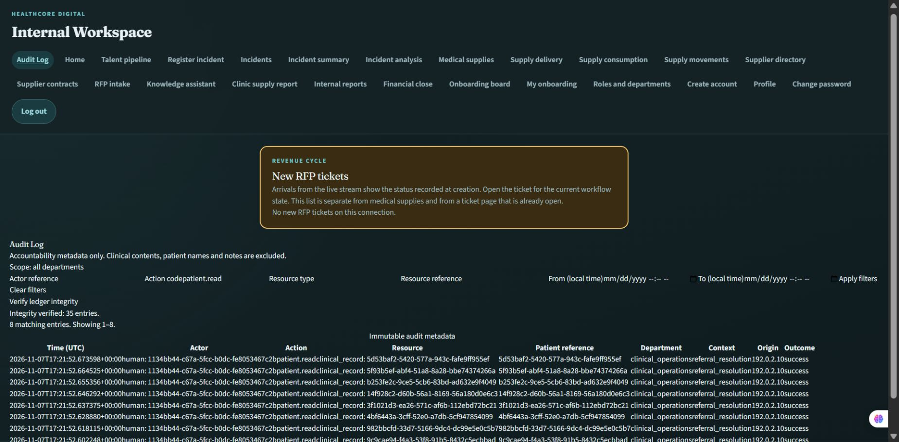

# Enhance Your Platform 3: Audit Log

Status: implemented and verified for CTO review. No CTO signoff or merge is implied. All branch changes are based on main b93a51c; held PR44 is not included.

## Sources

All applicable files in the supplied `.project_specs/ENHANCE YOUR PLATFORM/Task 3` folder were read: `project_specs.md`, `healthcore-BRIEFING-Audit Log.md`, the general company briefing and appointment policy. The general briefing supplies company context; this assignment does not create an EHR, claim system or appointment scheduler. The full assignment screenshot was visually reconciled with project_specs.md and confirms the same requirements and Platform task numbering.

## Storage and schema

The dedicated SQLite ledger is separate from operational TinyDB/SQL data. Configure `AUDIT_DB_PATH`; otherwise it lives beside the configured authentication store. Deploy it on restricted durable storage, with backups and monitoring. Do not put a real ledger in Git.

Entries contain actor kind and opaque actor reference, actor department, optional initiating human reference, fixed action code, resource kind and opaque resource reference, optional opaque patient UUID, department scope, server UTC timestamp, IP or fixed process origin, fixed nonclinical context, outcome, operation UUID and optional HTTP status. No request/response bodies, emails, names, diagnoses, clinical notes, credentials, Microsoft tokens or worker arguments/results are copied.

Application interfaces only append or read. SQLite triggers reject UPDATE/DELETE. Appends serialize under BEGIN IMMEDIATE, linking SHA-256 to the preceding entry. A separate head checkpoint detects removed tails. Integrity verification checks the full chain and checkpoint; selected query entries are validated before return. This detects edits and partial deletion; it does not protect against an unrestricted filesystem administrator recomputing the entire chain and checkpoint. External immutable anchoring and restricted storage are operational hardening, not claimed here.

## Existing sensitive-action inventory and capture boundaries

The HTTP capture inventory covers authentication and federation, users and assignments, roles/departments/access administration, profiles, internal reports, incidents, inventory, suppliers/contracts, RFP, onboarding, financial close, agent/knowledge execution, tasks, reporting and audit queries. It matches canonical registered route templates, captures attempted access before execution and outcome afterward, and uses trusted authenticated identities. Invalid credentials remain anonymous. Unavailable durable capture fails closed before the sensitive operation. An outcome-storage failure returns an explicit uncertain-result message; callers must inspect state before retrying.

Direct user-service create/update/delete calls are captured too, including role changes, deactivation and both sides of department transfers. Real incident, onboarding, supplier and financial worker entry points have process attribution and attempt/outcome capture. Agent HTTP execution additionally records the process actor and initiating human without result text. The real background chat-generation entry point is also wrapped; reporting uses its actual /reporting prefix.

The current baseline contains no operational clinical-record, patient-billing or insurance-claim endpoints. The reusable patient-event boundary requires opaque patient_ref and a fixed read/modification/claim/export/agent action. Eighteen explicitly synthetic seed records cover reads, clinical/billing modifications, claim decisions, export and automated patient access. These demonstrate the required audit format; they are not evidence of live clinical integrations. A future clinical adapter must invoke the boundary at its authorized access/mutation point with the correct purpose/context. Do not claim nonexistent patient workflows are instrumented.

## Access and querying

GET /audit-log supports actor, action, resource kind/reference, UTC date range and bounded pagination (1-100 rows). Admins see metadata across departments; Supervisors are forced to their own department; Employees and unassigned Supervisors are denied. GET /audit-log/integrity is Admin-only. There are no audit mutation endpoints. Existing canonical account roles are preserved.

Daniel explicitly approved the protected tracker page, panel, client/tests and AppShell navigation. The implemented viewer enforces the same role/department availability, offers structural and date filters, fixed 25-row pagination and an Admin-only integrity action. Server authorization remains authoritative.

## Synthetic seed

Run services/api/scripts/seed_audit_log.py --db <isolated-ledger-path> --synthetic-only. This is an explicit opt-in command, not startup population. It is idempotent by deterministic operation references and generates eighteen fictional opaque patient events.

## Verification

Final current API suite:181passed, zero failures/errors/skips. The initial two RFP failures were traced to the test fixture overwriting configured offline NLTK assets; honoring that configuration resolved them without changing evaluator logic, thresholds or assertions. Historical failure/baseline summaries remain available as before-fix evidence.

Focused Audit/chat44pass; all80UIJest/fullTypeScript/lint/productionbuild checks pass. Independent real Celery worker and built-browser access/filter/integrity checks pass. See the final evidence mapping below.

## Final evidence and evaluation mapping

- Append-only model/storage: shared/healthcore_audit/store.py; direct UPDATE/DELETE rejection, offline tamper and removed-tail tests in test_audit_log.py. No public mutation path exists.
- Actor/action/resource/time/origin: fixed validated event schema, trusted HTTP actor context, direct user mutations and automated task wrappers. Domain data and payloads are excluded.
- Captured sensitive actions: the inventory above is implemented in app/audit/middleware.py, app/audit/capture.py, worker decorators and the actual background chat entry point.
- Process attribution: actual independent Celery incident worker proof records attempted/success with process:incident-analysis and the same opaque task ID. This proof deliberately uses the cached-result path; it does not claim a new model or clinical integration.
- Metadata-only company rules and synthetic seed: strict-field/privacy tests plus eighteen idempotent synthetic patient entries cover read, modification and export.
- Query/filter/pagination/access: API scope/filter tests and built-browser evidence for Admin full scope + integrity + patient.read filtering, Supervisor Clinical Operations-only rows with no global integrity action, and Employee hidden navigation + denied direct page.
- Required tests: focused44 pass (21 Audit Log,23 chat); full current API181 pass with zero failures/errors/skips. The two initial RFP failures were reproduced and then resolved by the offline-resource fixture correction; no assertion or production threshold was weakened. UI80 Jest tests plus full TypeScript, lint and production build pass. Counts overlap.

Machine-readable summaries and browser screenshots are in audit-log-evidence/.

### Review limitations

This adds no operational EHR, billing or claim system: none exists in the starting baseline. The patient adapter and fully synthetic samples satisfy the required audit boundary/seed without inventing unrelated healthcare workflows. Database triggers and chaining protect the application interface and make ordinary edits evident; an unrestricted administrator who rewrites the chain and checkpoint is outside that guarantee. External immutable anchoring remains an operational control. Optional unusual-access analytics are not implemented. CTO review/signoff and explicit merge approval remain required.
